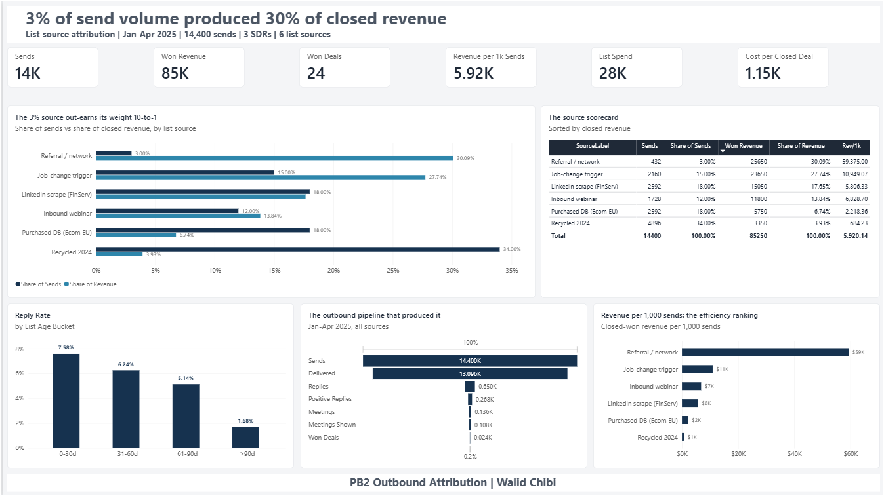
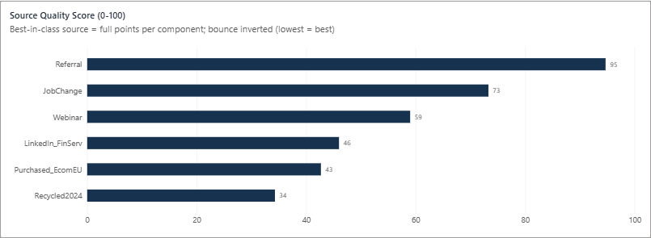
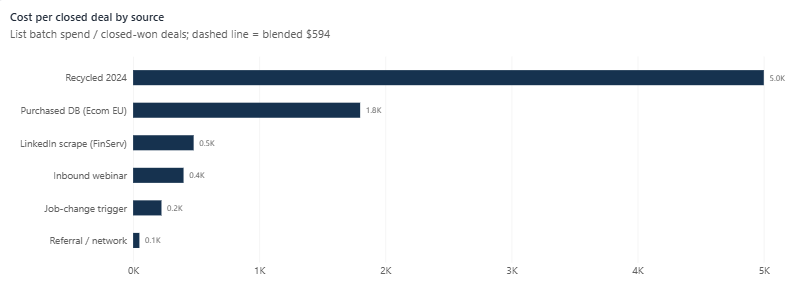
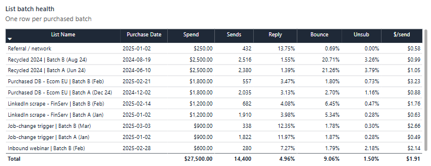
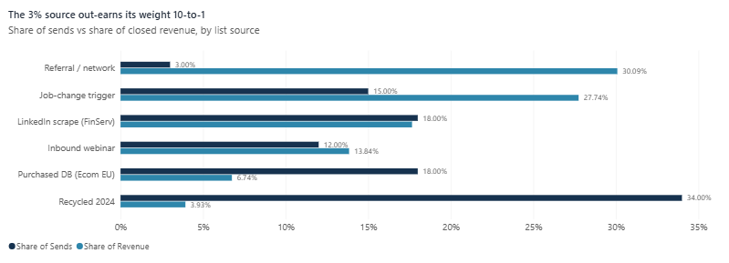
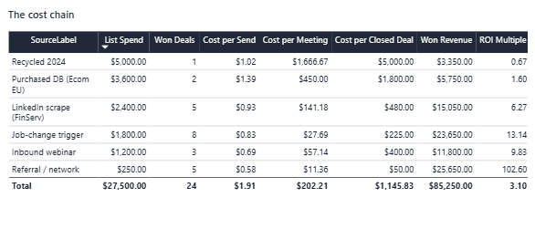
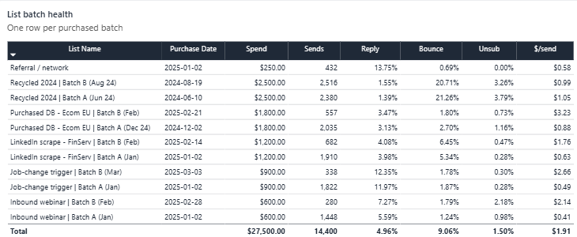
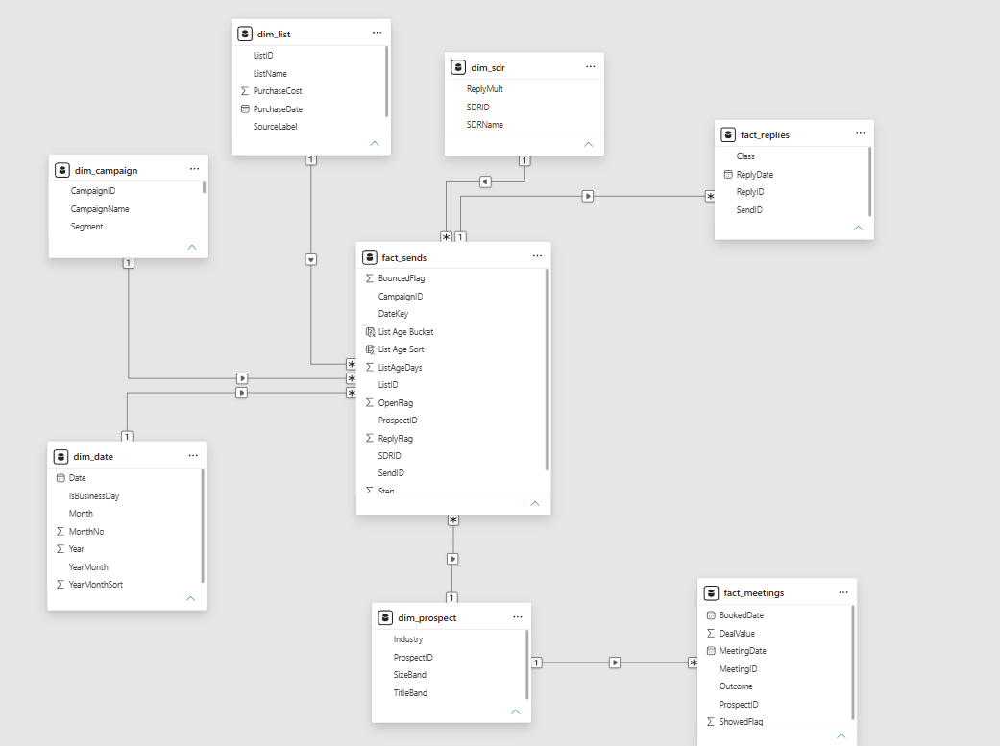

# Outbound Attribution Dashboard | Power BI

> **The hook:** one list source got **3% of send volume** and returned **30% of closed
> revenue**. Another got **34% of volume**, returned **4%** - and cost **$5,000 per
> closed deal**, against **$50** for the winner. This dashboard prices every
> prospect-list source per closed deal and tells you which to **SCALE**, **REPAIR**
> or **RETIRE**.



Most outbound teams know their reply rate. Almost none can trace closed revenue back
to the list source each send came from - their CRM sees campaigns, not list
provenance. This project closes that gap end to end: every send carries the batch it
came from, every meeting traces back to the prospect's sends, and every measure
respects that path. The result is a per-source P&L for outbound - not "which campaign
worked," but "which list buys are worth repeating."

**The decisive numbers (synthetic demo data, fully reproducible):**

| Question | Answer on screen |
|---|---|
| Which source actually produces revenue? | Referral: 3.0% of sends -> **30.1% of closed revenue** ($59,375 per 1k sends) |
| What does a deal cost per source? | **$50** (Referral) to **$5,000** (Recycled 2024) - a **100x spread** |
| Which sources earn budget? | Quality Score 0-100: **2 SCALE / 2 REPAIR / 2 RETIRE** |
| Why do lists stop working? | Reply rate decays **7.6% -> 1.7%** by list age; lists past 60 days drive **84% of bounces** |

## The four pages

| Page | Verdict on the cover |
|------|---------------------|
| **01 Overview** | 3% of send volume produced 30% of closed revenue |
| **02 Quality** | Two sources earn SCALE. Two need REPAIR. Two are beyond repair. |
| **03 Cost** | A Recycled-2024 deal costs $5,000 in list spend. A Referral deal costs $50. |
| **04 Decay** | Past 60 days, a list loses two thirds of its pull |

<p align="center">
  
  
</p>
<p align="center">
  
</p>

## The numbers behind the verdicts

Every figure below is a validated output of this dataset (seed = 7). Spend is
batch list purchase cost ($14,250 total) allocated through the model; Quality Score
weights reply 30 / positive reply 25 / bounce 20 / show 15 / close 10, each
normalized against best-in-class.

| Source | Sends (share) | Won deals | Closed revenue | Rev / 1k sends | Cost / deal | Quality Score | Disposition |
|--------|--------------:|----------:|---------------:|---------------:|------------:|--------------:|-------------|
| Referral | 432 (3.0%) | 5 | $25,650 | $59,375 | $50 | 94.7 | **SCALE** |
| JobChange | 2,160 (15.0%) | 8 | $23,650 | $10,949 | $225 | 73.4 | **SCALE** |
| Webinar | 1,728 (12.0%) | 3 | $11,800 | $6,829 | $400 | 59.0 | **REPAIR** |
| LinkedIn_FinServ | 2,592 (18.0%) | 5 | $15,050 | $5,806 | $480 | 46.0 | **REPAIR** |
| Purchased_EcomEU | 2,592 (18.0%) | 2 | $5,750 | $2,218 | $1,800 | 42.8 | **RETIRE** |
| Recycled2024 | 4,896 (34.0%) | 1 | $3,350 | $684 | $5,000 | 34.3 | **RETIRE** |
| **Total** | **14,400** | **24** | **$85,250** | **$5,920** | **$594** | - | 2 / 2 / 2 |

Funnel behind those rows: `14,400 sends -> 13,096 delivered -> 650 replies ->
268 positive -> 136 meetings -> 108 shown -> 24 won -> $85,250` (Jan-Apr 2025,
3 SDRs, 60 business days).

Evidence close-ups:

<p align="center">
  
  
</p>

Page 4's decay story, with batch health as the receipt: reply rate falls from
7.6% (lists 0-30 days old) to 1.7% (past 90) - a weighted drop of ~61% once a list
passes 60 days - while aged lists account for 84% of all bounces and one source
(Recycled 2024) alone produces 79% of them.



## How it's built

**Model:** classic star schema, 8 tables, 7 relationships, all one-to-many, all
single-direction - no bidirectional filters anywhere. The attribution path is
multi-hop and runs through the prospect dimension:

```
dim_date --1:*-- fact_sends *:1-- dim_list
                     |              (SourceType = the attribution key)
                     *:1
                  dim_sdr
                     |
                     *:1
                dim_prospect --1:*-- fact_meetings
                                  |     (multi-hop: sends -> prospect -> meetings)
                             dim_campaign
```


- `fact_replies` joins to `fact_sends` on `SendID`.
- Closed revenue filters back to list sources through
  `meetings -> prospect -> sends -> list`.
- The bridge is unlocked **inside measures** with
  `CROSSFILTER(fact_sends[ProspectID], dim_prospect[ProspectID], BOTH)`, never at
  model level. The data guarantees each prospect is contacted from exactly one
  source, so attribution is exact - no double-counting by design.

**Measure layer:** ~45 DAX measures. Three families do the heavy lifting:

- **Funnel & rates** - `DIVIDE` discipline, delivered-base reply rates, no averages
  of averages.
- **Cost chain** - batch spend allocated through the model:
  `Cost per Send -> Cost per Meeting -> Cost per Closed Deal -> ROI Multiple`
  (blended $594/deal, 6.0x; Recycled 2024 at 0.7x is the only source below 1.0).
- **Source Quality Score** - five components (reply 30 / positive 25 / bounce 20 /
  show 15 / close 10), each normalized against best-in-class with bounce inverted.
  Components are separate composable measures (a `MAXX/MINX` over `ALLSELECTED`
  pattern), so the stacked bar shows *where the points come from* - not just the total.

**Dispositions:** `SWITCH(TRUE(), score >= 70, "SCALE", score >= 45, "REPAIR", "RETIRE")`,
rendered with fx color rules - blue / amber / ember - consistent across every visual.

## The dataset

8 CSVs, fully synthetic, safe to publish:

| File | Rows | Grain |
|------|-----:|-------|
| `fact_sends.csv` | 14,400 | one row per email send |
| `fact_replies.csv` | 650 | one row per reply received |
| `fact_meetings.csv` | 136 | one row per meeting booked |
| `dim_list.csv` | 11 | list batches (source, cost, purchase date) |
| `dim_campaign.csv` | 6 | outbound campaigns |
| `dim_prospect.csv` | 8,519 | prospects (industry, size, title) |
| `dim_sdr.csv` | 3 | SDR roster |
| `dim_date.csv` | 108 | business-day calendar Dec 2024 - Apr 2025 |

Design choices worth noting: meeting outcomes after 2025-04-21 stay `Pending` to
simulate a realistic "too recent to know" tail; `DealValue` on non-Won rows is a
placeholder (revenue measures filter to Won only); every text column that needs
custom ordering ships with a numeric sort key.

## Repo tour

```
outbound-attribution-dashboard/
├── README.md              <- this file
├── data/                  <- the 8 CSVs (synthetic - safe to publish)
├── etl/
│   └── pb2_generator.py   <- regenerates data/ deterministically (seed = 7)
├── dashboard/
│   └── theme/             <- Navy & Ember Power BI theme JSON
├── screenshots/           <- the 10 shots behind this README
└── docs/
    ├── data-dictionary.md            <- every column, every table
    ├── step1-model-setup.md          <- exact relationships, types, smoke tests
    ├── step3-4-measures-and-pages.md <- full DAX measure layer + page specs
    ├── qa-backup.md                  <- 11 likely stakeholder questions, answered
    └── qa-validation.txt             <- generator validation run (4 insights PASS)
```

## Reproduce it

```bash
git clone https://github.com/SkyblyeAgency-Walid/outbound-attribution-dashboard.git
cd outbound-attribution-dashboard/etl
python pb2_generator.py        # pandas + numpy, ~2 seconds, byte-identical output
```

Then:

1. Load `data/*.csv` into Power BI Desktop following `docs/step1-model-setup.md`
   (relationships, column types, sort keys, and three smoke tests with expected
   numbers are all specified there).
2. Paste the measure layer from `docs/step3-4-measures-and-pages.md`.
3. Every number in this README appears on screen - no PBIX download needed to
   audit the logic.

## Skills on show

Star-schema modeling | multi-hop attribution with `CROSSFILTER` discipline |
composite scoring in DAX | fx conditional-formatting systems | px-precise report
design | demo-data engineering (seeded generator + pre-baked, validated insights)

---

*Demo data is synthetic. The methodology, model and measure layer are the product -
and they run unchanged on a client's real export (see Page 5 mapping template).*
